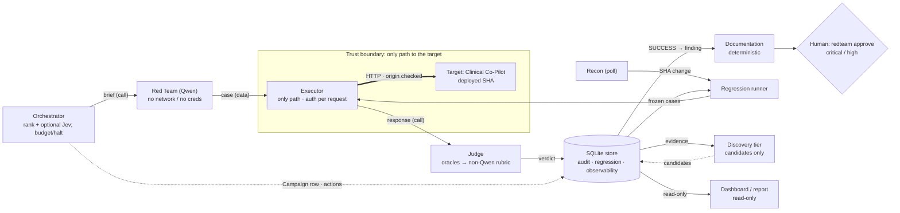

# Architecture

> PRD Stage 4 hard gate. Companion records: `docs/adr/0001–0005`, `CONTEXT.md` (vocabulary),
> `docs/DATA_MODEL.md`, `docs/EXTERNAL_APIS.md`, `docs/PERF.md`, `docs/COST_ANALYSIS.md`,
> `docs/INTEGRATION_PACKET.md`, `docs/ATO_PACKET.md`, and `docs/PLAN.md` (requirements matrix and
> decision log). `THREAT_MODEL.md` and `USERS.md` are the inputs this plan assumes. Status labels
> follow `AGENTS.md`: a capability is *done* only when it is wired, tested, and observed live;
> otherwise this document says `implemented, not wired`, `wired, untested`, or `not done`.

## Summary

The AgentForge Red Team platform continuously attacks one authorized target, the AgentForge
Clinical Co-Pilot, and records whether its weaknesses are found, fixed, and stay fixed. The design
is a **deterministic control plane that calls LLM-backed roles in-process and persists every
handoff to one SQLite store**. The store is the audit trail, the regression suite, and the
observability substrate the Orchestrator reads; it is not a message queue, and the agents are
called synchronously, not through it. One store means no second state to drift.

Four requirements are structural, not conventional. First, **Judge independence**: the verdict
comes from deterministic oracles first, and an LLM rubric tier runs only where no oracle exists,
on a different model family from the attacker (a model-name check rejects a Qwen rubric model).
Second, **authorization by construction**: one deterministic Executor is the only code that opens
a socket to the target, and it checks `authorization.yaml` on every request and never follows
redirects. The Red Team agent holds no network access and no credentials and emits attack text as
data. Third, **auditability**: every agent action is an ordered `agent_actions` row, every write
is part of an atomic unit of work, and a finding links back through verdicts, attempts and
evidence to the exact request and response. Fourth, **honest verdicts**: a missing, errored or
empty response is `INCONCLUSIVE`, never a pass, and a provider content block is a typed outcome,
not evidence that a defense held.

The roles are the **Orchestrator** (a deterministic ranker over per-route coverage and open
findings, with an optional Jev selector among the top candidates and hard budget and halt rules it
cannot override), the **Red Team agent** (Qwen; generates attacks and one guarded mutation), the
**Judge** (oracles, then the rubric tier), and the **Documentation agent** (a deterministic,
template-driven report writer, not an LLM). The deterministic services are the **Executor**, the
**Regression runner** (replays frozen findings through their original probes, triggered by the
`redteam poll` Recon service on a new target SHA), and **Recon** (SHA polling today). A separate
**Discovery tier** reviews captured evidence with an independent LLM and emits candidates for
human triage, never verdicts. Human approval gates sit where a wrong autonomous call is costly:
publishing critical or high reports and editing the authorization registry. The platform never
proposes or applies fixes to the target.

Cost is controlled by putting free work on the high-volume paths. Oracles, authorization probes,
token minting and regression replay make no model calls; only attack generation, mutation, rubric
judging and discovery do. In the store, 139 of 172 attempts needed no attacker model. Cost scales
with model calls, not attempts; see `docs/COST_ANALYSIS.md`. Where a capability is only designed or
only unit-tested, this document says so; the last section is a wired, tested and live status table
for the base commit, and the platform's own LLM-driven attack path has so far produced no finding.

## Agents and services

Every component runs in one Python process per CLI command. "Coordination" names what actually
happens in the code, not the intended message flow.

| Component | Kind | Role | In → Out | Trust | Coordination (as built) |
|---|---|---|---|---|---|
| **Orchestrator** | Deterministic ranker; optional Jev LLM selector (off by default) | Chooses the next campaign: (category, route) brief | store state (campaign coverage, open findings) → a brief and a `Campaign` row | Decides; **cannot** override budget, halt or authorization | Calls `run_campaign` in-process; writes one `Campaign` row per brief with its outcome |
| **Red Team** | LLM agent (Qwen) | Generate a case from a brief; mutate a non-success once | brief → `SeedCase` (data only) | **Least trusted**: no network, no credentials | Called by the campaign loop; its specs are persisted with the attempt |
| **Judge** | Oracles, then non-Qwen rubric LLM | Rule SUCCESS, FAIL or INCONCLUSIVE | `Observation` → `Verdict` | Independent of the attack engine | Called by the runner; the verdict and its audit action commit in the attempt's unit of work |
| **Documentation** | **Deterministic code, no LLM** | Confirmed finding → report | `Finding` → `VulnReport` | Writes reports; high and critical held for a human | `redteam document <finding_id>`; validates finding fields first |
| **Executor** | Deterministic service | The only path to the target; authorization per request | URL + request → `ResponseRecord` | Holds the origin allow-list; mints tokens through itself | Called by the runner, minter, recon and probes |
| **Regression runner** | Deterministic service | Replay frozen cases on a build; flag reappearance | `regression_cases` + SHA → attempts | Deterministic | `redteam regression`, or triggered by `redteam poll` on a SHA change |
| **Recon** | Deterministic service | Poll `/health` for `git_sha`; trigger regression on change | `/health` → target-health row, regression run | Read-only against the target | `redteam poll`, cron-friendly; route inventory is `not done` |
| **Discovery tier** | LLM reviewer (non-Qwen by default) | Open-ended review of stored evidence | attempts → `discovery_candidates` | Leads only; cannot write findings | `redteam discover`, or `redteam poll --discover` |

Human-facing outputs: a **static dashboard** (`redteam dashboard`, one self-contained HTML file;
no server and no login), a markdown report (`redteam report`), and a **CLI approval** path
(`redteam approve`) that writes an approval record into the report row.

## Interaction diagram

Solid arrows between agents are in-process calls; every call's result is then persisted to the
store inside one atomic unit. Dotted arrows are writes that are not part of a verdict path.

## The eight Stage-4 questions

1. **Which agent owns each function.** Attack generation: Red Team. Evaluation: Judge. Strategic
   prioritization: Orchestrator. Reporting: Documentation (deterministic). Execution against the
   target: the Executor, deliberately not an agent. Regression replay and recon: deterministic
   services. Open-ended discovery: the Discovery tier.
2. **How agents communicate.** In-process function calls, with the result of each step persisted to
   the store. Versioned JSON Schemas for `Campaign`, `AttackSpec`, `Attempt`, `Verdict`, `Finding`,
   `VulnReport` and a typed `error` live in `/contracts/v1`. Conformance is **checked in tests**
   against real persisted rows (producer side); nothing validates a message against its schema at
   runtime, and no consumer-side check exists. The schemas are written so an independently built
   agent could plug in, but no peer integration has been done (`docs/INTEGRATION_PACKET.md`). The
   store is not a work queue: a "failed agent never blocks a producer" is not a property of this
   build, because there is no producer/consumer decoupling.
3. **How the Orchestrator picks the next target.** Each candidate is a (category, route) pair. Its
   score is an exploration term `1 / (1 + tested campaigns)` plus an exploitation term for
   categories with open findings, capped at 0.49 so an open finding can never out-rank an untried
   pair, minus a run-scoped penalty for pairs that could not be tested. A pair with two untested
   outcomes (skipped, provider-blocked, errored, unreachable) in one run is retired for that run.
   Coverage is counted from `Campaign` rows only, scoped to the target. Two signals feed the score
   (coverage and open findings). "Routes changed since the last tested SHA" and "estimated
   campaign cost" are **not** ranking inputs: SHA change triggers regression through Recon, and cost
   is bounded by the `--max-model-calls` cap. The Jev selector (`--selector jev`, key-gated) picks
   among the top 3 and falls back to the deterministic top-1 below a confidence floor of 0.5. It is
   `wired, tested with stubs, not observed live`: all 60 `select` actions in the store are
   deterministic.
4. **How Judge verdicts feed regression.** A SUCCESS verdict is promoted to a finding, deduplicated
   on `(violating oracle, sink, category)`, and frozen as a `regression_case` with its `probe_kind`
   so it replays through the same probe that found it. A replay of `SUCCESS` is a reappearance;
   only a clean `FAIL` counts as held; `INCONCLUSIVE` is neither. Replay re-runs the **exact frozen
   case**: there is no mutated-variant replay, so "the fix generalizes past the exact string" is
   `not done`.
5. **Where human gates sit.** Critical and high report publication (`redteam approve`); changes to
   `authorization.yaml` (a git-tracked file only a human edits). The gate fails closed: an unknown
   severity or a finding with no evidence is held. Not built: a review queue for inconclusive
   verdicts and a clinical-harm lane. `INCONCLUSIVE` verdicts are recorded and counted in
   `redteam report`; nothing routes them to a person. The platform never proposes or applies fixes.
6. **AI versus deterministic.** AI where the task is open-ended language: attack generation and
   mutation, rubric judgment of oracle-less classes (excessive agency), optional campaign
   selection, and discovery. Deterministic wherever a wrong or drifting result is unacceptable: the
   authorization gate, budget and halt, all oracles, regression replay, the ranker, and reports.
7. **Cost, rate limits, model constraints at scale.** See the next section, `docs/EXTERNAL_APIS.md`
   and `docs/COST_ANALYSIS.md`. The cost circuit-breaker is the run-spanning `CallBudget`
   (`--max-model-calls`, default 200), checked before every metered call.
8. **State and coordination infrastructure.** A hand-rolled control plane over SQLite (ADR 0001),
   no graph or agent framework. The store owns transactions: every logical unit (a judged attempt,
   a replayed case, a report, a recon trigger) commits or rolls back together. LangGraph is the
   documented revisit trigger if agent count or branching grows.

## Rate limits, authentication and failure handling

Full per-API table: `docs/EXTERNAL_APIS.md`. The behavior, as built:

- **Target:** the Executor sends one request, with a 90 s timeout and no redirects, and does **not**
  retry or back off. A transport failure raises `TargetUnreachable`, which the runner records as an
  `INCONCLUSIVE` attempt. The token minter alone retries a mint `429`: up to 2 retries, waiting
  `Retry-After` (capped at 60 s), then raises `TargetUnreachable`. There is no queue; the policy is
  abort-to-INCONCLUSIVE.
- **Attacker and rubric models:** bearer-key authentication from the environment. For the attacker,
  a timeout or HTTP error raises `TargetUnreachable` (retriable) and the brief is `errored`; a
  content-filter block raises `ProviderBlock` and the brief is `provider_blocked`; neither is
  retried. A failed or unreadable rubric call degrades that one verdict to `INCONCLUSIVE`. In the store, 40
  of 47 brief errors are attacker-model read timeouts at the 90 s default
  (`AGENTFORGE_REDTEAM_TIMEOUT` raises it). The budget cap, not backoff, bounds volume.
- **Jev:** key-gated; any vendor error falls back to the deterministic top-1.
- **Authorization:** the target is selected by id from `authorization.yaml`; the registry loads
  fail-closed (`enabled` must be a YAML boolean, an enabled entry needs non-empty `proof`).

## Data model, migrations, indexes and SLO

- **Migration approach:** numbered, additive SQL files (`0001`–`0009`, schema v9 in the canonical
  store). Each applies atomically with its `schema_version` row, a failure rolls back and names the
  file, and an applied file is never edited: a new field is a new `ALTER TABLE ... ADD COLUMN` with a
  default, so existing rows migrate without loss (`0005` added `schema_version` to five tables,
  `0009` added `outcome` and `schema_version` to `campaigns`). Verified by
  `tests/test_store.py::test_an_older_store_with_rows_migrates_forward_without_loss` and, per
  `docs/PLAN.md`, on copies of the v8 store and the three older backups. A store opens its own
  migrations on first use.
- **Queue-depth monitoring:** `queries.queue_depth` reports `campaigns_pending` (rows with status
  `new`) and `reports_pending_approval`. Honest state: **no code inserts a campaign with status
  `new`**, because campaigns run synchronously, so `campaigns_pending` is always 0 and only the
  approval backlog is live (3 reports pending in the canonical store). If a worker pool is added
  (see `docs/PERF.md`), campaign rows would be enqueued as `new` and this metric becomes real; a
  backlog would then be the signal to scale workers or lower the campaign budget.
- **Indexes** (migrations `0001`–`0009`), by query pattern: findings by severity
  `ix_findings_severity(severity_score)`, by category `ix_findings_category` and
  `ix_attack_specs_category`, by status `ix_findings_status`, by system version
  `ix_attempts_target_sha` (and `ix_benign_runs_sha`); joins `ix_attempts_spec`,
  `ix_verdicts_attempt`, `ix_evidence_attempt`, `ix_regression_finding`; audit
  `ix_agent_actions_campaign(campaign_id, ts)`; coverage `ix_campaigns_target_outcome`.
  `findings.dedup_key` is `UNIQUE`.
- **SLO:** a full regression replay completes within **5 s of platform overhead** (target latency
  excluded). `tests/test_slo.py` asserts every hot query uses an index and times a stub-sender
  replay under that ceiling. On this machine the overhead is 10 to 14 ms per frozen case (500
  cases in 4.8 to 6.8 s over three runs), so the 5 s bound holds up to roughly 350 to 500 frozen cases; it is
  `measured locally`, and `not verified in CI` because the GitLab pipeline has no runner
  (`docs/PERF.md`).

## AI-use disclosure

| AI role | Model (set by environment) | Deterministic check or human gate that follows | Residual risk |
|---|---|---|---|
| Red Team generation and mutation | Qwen via an OpenAI-compatible endpoint (`AGENTFORGE_REDTEAM_MODEL`) | Output is data; the Executor sends it; oracles judge the response; the platform, not the model, sets the oracle marker and DoS budget | Provider content filter may block a generation (typed `provider_blocked`); frequent read timeouts |
| Judge rubric tier | A non-Qwen model (`AGENTFORGE_REDTEAM_RUBRIC_MODEL`; DeepSeek in use) | Runs only where no oracle applies (excessive agency); never overrides an oracle VIOLATION; unreadable or failed replies are INCONCLUSIVE | Independence is a model-name check, not a proof of a different training lineage; judge bias or drift; 12 verdicts in the store carry a rubric result |
| Orchestrator selector | Jev `jev-1.13.0`, optional, off by default | A deterministic ranker produces the candidates; budget, halt and authorization are outside it; low confidence or vendor error falls back to top-1 | Jev's base model is undisclosed; never observed live |
| Discovery tier | Non-Qwen by default; an explicit same-family model is honored (Qwen Max recommended) | Emits candidates only to `discovery_candidates`; a human triages each; a confirmed one is hardened into a deterministic oracle | False-positive leads (12 of 32 dismissed); no authority to open a finding |
| Documentation | **No AI** | n/a: template-driven from stored fields; critical and high held for a human | Wording is generic per category, not tailored by a model |

Model names above are configuration read from the environment; they cannot be verified from the
repository, which holds no key or model pin beyond `jev-1.13.0`.

**Detecting and correcting a drifting Judge.** The deterministic tier cannot drift: it is pure code,
so a drift question applies only to the rubric tier and to oracle rules.

1. *Measured now:* `redteam calibrate` scores the Judge against `evals/calibration/calibration_v1.yaml`
   (12 entries: 10 deterministic, 2 rubric) for agreement and Cohen's kappa (`src/redteam/drift.py`).
   The 10 deterministic entries agree (10 of 10, kappa 1.00) without a model; the 2 rubric entries
   run only when a rubric model is configured. The set still reports `NOT VALIDATED`: its labels are
   `review_status: unreviewed` until a human flips them. Run it after any rubric model, prompt or
   oracle change; a drop in agreement is the correction trigger (revert the change, or relabel
   with a human).
2. *Replay stability:* the frozen regression cases are re-judged on every build; an oracle change
   that flips a historical verdict shows up as a changed `last_result`. The frozen-case check
   (`tests/test_frozen_cases.py`, `REDTEAM_FROZEN_CHECK_STORE`) re-judges stored attempts offline
   and compares outcomes.
3. *Not built:* a two-judge pairing whose disagreement is a label-free drift alarm; rerun-stability
   scoring of the rubric tier. A retired pinned rubric model fails closed, since an HTTP error is
   INCONCLUSIVE, but nothing alarms on that rate.

## Known tradeoffs, failure modes, and edge cases

| Situation | Behavior (as built) | Rationale |
|---|---|---|
| **Executor is a single serialized door** | Accepted by design; the load test attributes the throughput ceiling to it (`docs/PERF.md`) | One door is what makes authorization structural |
| **Target unreachable or 5xx** | Attempt is `INCONCLUSIVE`; a brief where every attempt failed to connect is `unreachable` and counts as untested | A missing verdict is never a pass |
| **Budget exceeded mid-campaign** | `BudgetExceeded` stops the run cleanly (brief `budget_halted`); the call that would exceed is never made; no resume point is stored | Cost accruing without signal must halt |
| **Judge cannot decide** | `INCONCLUSIVE`, recorded and counted; no human review queue exists | Fail closed |
| **Provider content block** (attacker side) | Typed `provider_blocked` brief outcome, no retry or fallback model | A filter is not the target's defense |
| **Target degrades (sparse retrieval)** | The `Attempt` contract has `retrieval_mode`, but the runner does not populate it and the Judge does not read it. Only the benign over-refusal set treats retrieval failure as inconclusive | Gap, `not done` |
| **Agent crash or timeout** | No queue and no retry; the unit of work rolls back, so no half-written verdict. `redteam integrity` lists any attempt without a verdict | Atomic persistence replaces retry |
| **Regression "passes" after a fix** | Only a clean `FAIL` through the original probe counts as held; behavior shift alone is INCONCLUSIVE | PRD's central regression warning |
| **Red Team output is itself harmful** | Never executed except through the Executor against the authorized synthetic target; stored as data | Synthetic-only, single-target boundary |
| **Why not LangGraph, CrewAI, or one red-team tool** | ADR 0003 considered-options; ADR 0005 build-vs-configure | Second state store; shared-context judge; no orchestrator or harness |

## Standing risks and gaps

- We own recovery logic a framework would provide; atomic persistence and fault-injection sweeps
  cover storage, not agent-level retry.
- **PyRIT, garak and spikee are not wired.** `AGENTS.md`, `KICKOFF.md` and ADR 0005 plan them as
  runtime tools; none is in `pyproject.toml`, `uv.lock` or `src/`. The Red Team calls the Qwen
  endpoint directly.
- Pinned hosted model versions can be retired without notice; recalibrate after any change.
- The platform's own LLM-driven path has produced no finding; all seven came from deterministic
  probes (`THREAT_MODEL.md`).
- The local replica (`agentforge-w2-local`) is `enabled: false`; high-volume campaigns and the
  free-tier embedding-quota isolation planned in ADR 0003 are `not done`.
- Multi-turn attack sequences are N/A (the composer is stateless); mutation is one guarded rephrase,
  with `max_mutations=1` fixed in the Orchestrator.

## Discovery tier (open-ended, candidate-only)

`src/redteam/agents/judge/discovery.py` and `src/redteam/discovery.py`. An independent LLM
reviews each captured request and response with no checklist and emits **candidates**, never
verdicts and never findings, because the deterministic oracles and the rubric tier only recognize
pre-encoded classes. A human hardens a confirmed candidate into an oracle and probe; this produced
`MetadataDisclosureOracle` and F-ca9486ff1b. It writes only to `discovery_candidates`. In the
store: 32 candidates from two reviewers (DeepSeek and Qwen Max), 20 promoted to existing findings,
12 dismissed as false positives, 0 new classes (`docs/DISCOVERY_TRIAGE.md`).

## Implementation status (2026-10-01, base commit `2f3ea96`)

Wired = called by a CLI path. Tested = a test fails if it breaks. Live = recorded in
`var/redteam.db` (read through a copy) against the deployed target.

| Capability | Wired | Tested | Live | Note |
|---|---|---|---|---|
| Executor boundary and registry | yes | yes | yes | every run |
| Deterministic authorization battery | yes | yes | yes | `redteam authz` |
| Red Team generate and one mutation | yes | yes | yes | 33 attempts (22 generated, 11 mutations); all FAIL |
| Judge: oracles, one verdict path | yes | yes | yes | 172 verdicts |
| Judge: rubric tier | yes | yes | yes | 12 rubric-carrying verdicts; calls not metered before 2026-10-01 |
| Calibration (`redteam calibrate`) | yes | yes | n/a offline | kappa 1.00, awaiting human review flip |
| Orchestrator ranking and `Campaign` rows | yes | yes | yes | 3 campaigns from the 2026-10-01 run: 1 tested, 2 errored on attacker timeouts |
| Jev selector | yes | stubs only | no | 0 live selections |
| Documentation agent and approval gate | yes | yes | yes | 7 reports; 3 held pending approval |
| Regression replay (frozen case) | yes | yes | yes | last read on `926805ce`: held 5, reappeared 2 |
| Regression on SHA change (`redteam poll`) | yes | yes | no | `target_health` is empty in the canonical store |
| Discovery tier | yes | yes | yes | 3 passes, 32 candidates |
| Benign over-refusal set | yes | yes | yes | one run, build `da7451d1`: 0 of 11 |
| Atomic persistence and integrity check | yes | yes | yes | `redteam integrity`: 0 attempts without verdict, 0 findings without a case |
| Regression CI gate | no | n/a | n/a | the pipeline has no runner; run locally |
| Fix-holds under mutation | no | n/a | n/a | replay is exact-case only |
| State-diff oracle, tool-trace visibility | no | n/a | n/a | black-box |
| Peer-agent integration | no | n/a | n/a | solo build |
