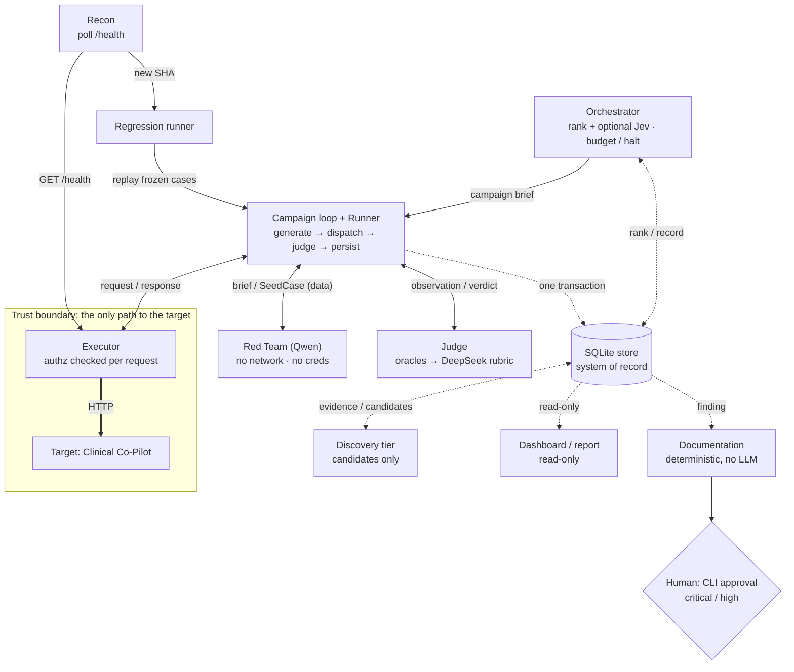
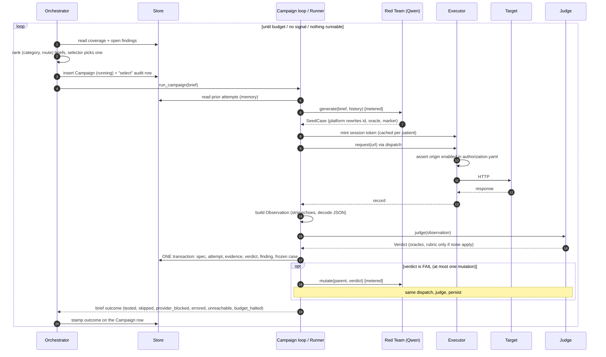
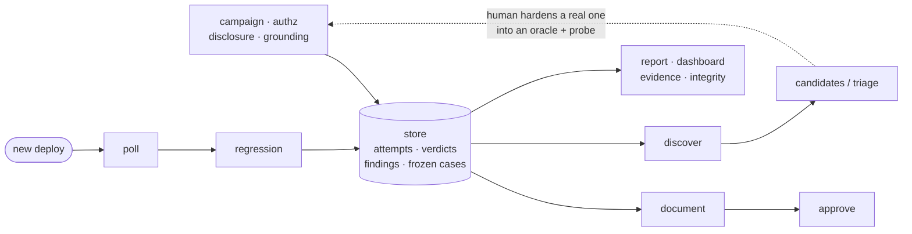
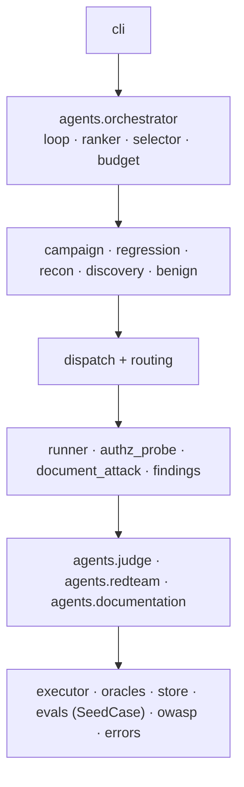

# Architecture

> PRD Stage 4 hard gate. Companion records: `docs/adr/0001–0003`, `CONTEXT.md`
> (vocabulary), `docs/PLAN.md` (requirements matrix + decision log). Threat model
> (`THREAT_MODEL.md`) and users (`USERS.md`) are written in the same workstream and are
> the inputs this plan assumes.

## Summary

The AgentForge Red Team platform continuously attacks one authorized target — the
AgentForge Clinical Co-Pilot — and proves whether its weaknesses are found, fixed, and
stay fixed, at a standard a hospital CISO would trust to run unattended. The design is a
**deterministic control plane coordinating four agent roles and a set of deterministic
services over one SQLite store**. Three of the agent roles call a model (Red Team, the
Judge's rubric tier, the Orchestrator's optional selector); Documentation is a
deterministic report builder. Control flow is an in-process call chain under one campaign
loop; the store is the **system of record** — the persisted product of every handoff, the
ordered audit trail, and the observability substrate the Orchestrator reads. The store as
single source of truth is the spine: every handoff product, every audit record, and every
signal the Orchestrator prioritizes on is the same set of rows, so there is no second
state store to drift. (The original design called the store a work queue that agents pull
from; the build is simpler and in-process. See "Design vs implementation" below.)

Four requirements are structural, not conventional, and they drove the shape. First,
**Judge independence**: attack generation and evaluation never share a context or a model
family, because an engine that both attacks and grades is compromised by design. Second,
**authorization by construction**: a single deterministic Executor is the only component
that can reach the target, and it checks an authorization registry on every request, so
the platform cannot be pointed at a system it does not own — the least-trusted component,
the Red Team Agent, holds neither network access nor credentials and emits attack text
only as data. Third, **auditability**: every agent action is an ordered row, and lineage
links any finding back through its verdicts, attempts, mutation ancestry, and the
Orchestrator decision that surfaced it. Fourth, **honest verdicts**: deterministic
oracles (canaries, state diffs, scope and schema checks) decide first; an LLM rubric tier
runs only where no oracle exists; degraded target behavior and upstream provider content
blocks are distinct outcomes, never counted as a pass.

The agents are the **Orchestrator** (hybrid: a deterministic ranker over coverage,
findings, regressions, and cost, with a pinned Jev model choosing among top candidates and
hard budget/halt rules it cannot override), the **Red Team Agent** (Qwen; generates and
mutates attacks and multi-turn sequences), the **Judge Agent** (oracles first, then a
pinned non-Qwen rubric model, validated against a human-labeled calibration set), and the
**Documentation Agent** (turns a confirmed finding into a professional report). The
deterministic services are the **Executor** (the sole path to the target), the
**Regression runner** (replays frozen cases on every new target SHA), and **Recon**
(route and SHA inventory). Human approval gates sit where a wrong autonomous call is
expensive: publishing critical/high reports, reviewing inconclusive and clinical-harm
verdicts, and changing the authorization registry. The platform never proposes or applies
fixes to the target; it only recommends remediation in report text.

Cost is controlled by putting the cheapest components on the highest-volume paths:
deterministic oracles ($0) and Jev (~$0.04/M tokens) run on every attempt and every
orchestration decision, while the costlier Qwen and rubric-model calls fire only when a
case needs generation or open-ended judgment. That shape, not a per-token multiple, is
what keeps the projection to 100K runs defensible.

## Agents and services

Each row gives role, inputs → outputs, trust level, and how it coordinates. Message
shapes are versioned JSON Schemas in `/contracts`; every handoff's product is persisted to
the store, and the schemas are conformance-tested against those persisted records. Calls
between components are in-process (see "Design vs implementation").

| Component | Kind | Role | In → Out | Trust | Coordination |
|---|---|---|---|---|---|
| **Orchestrator** | Agent (Jev + deterministic) | Chooses the next campaign: surface, cases, budget | store state (coverage, open findings, regressions, cost) → a `Campaign` | Trusted to decide; **cannot** override budget/halt/authorization | Writes campaigns to the store; triggers regression runs |
| **Red Team** | Agent (Qwen) | Generate novel inputs, mutate partial successes, specify multi-turn sequences | `Campaign` brief → `AttackSpec[]` (data only) | **Least trusted** — writes adversarial text; no network, no creds | Reads briefs, writes specs to the store |
| **Judge** | Agent (oracles + pinned non-Qwen rubric) | Rule success / partial / fail / inconclusive | `Attempt` → `Verdict` + evidence | Independent of the attack engine | Reads attempts, writes verdicts; feeds the regression harness |
| **Documentation** | Deterministic report builder (no LLM) | Confirmed finding → professional report | `Finding` → `VulnReport` | Writes reports; anything but an explicit low/medium with evidence is held for a human | Reads findings, writes reports; validates data-quality before write |
| **Executor** | Deterministic service | The only path to the target; auth check per request; plays out multi-turn specs | `AttackSpec` → `Attempt` (exact req/resp) | Holds credentials + synthetic identities; enforces the boundary | Reads specs, writes attempts; rate-limits and backs off |
| **Regression runner** | Deterministic service | Replay frozen cases on each new SHA; detect reappearance + cross-category regressions | `RegressionCase[]` + new SHA → `Attempt[]` | Deterministic replay | Triggered by the Recon poll on a new SHA or by `redteam regression`; replays through the same `dispatch` and the Executor |
| **Recon** | Deterministic service | Route/SHA inventory; poll `/health` for target change | target-visible metadata → coverage + SHA signals | Read-only against the target | Records the build SHA; triggers regression (and optionally discovery) on a change |

Deterministic, human-facing outputs: a **read-only dashboard** (coverage per category,
pass/fail over versions, resilience trend, open findings, cost) and a **CLI approval**
path that writes an approval record into lineage.

## Interaction diagram



Solid arrows are in-process calls, dashed arrows are reads and writes of the store, and the
thick arrow is the only network edge. An interactive version with per-component trust levels is
[docs/architecture.html](docs/architecture.html).

## How the repo works

A map for reading the code, checked against it on 2026-10-01. The platform is one Python
package (`src/redteam/`, run as `uv run redteam <command>`) over one SQLite file
(`var/redteam.db`). Every command is a thin entry point onto the same small set of mechanisms.

### Seven ideas that explain most of the code

1. **One currency: `SeedCase`** (`evals/case.py`). A hand-authored YAML seed, an attack the Red
   Team generates, a mutated variant, and a frozen regression case are all the same pydantic
   model: ordered `turns` (method, route, body), an `OracleConfig`, a category, and OWASP tags.
2. **One execution funnel.** Anything that touches the target goes
   `dispatch` → one of `run_case` / `run_authz_case` / `run_document_attack` / `run_probe` →
   `Executor.request` → `build_observation` → `Judge.judge` → `finalize`. Live campaigns,
   deterministic probes, and regression replay share it, which is what makes replay faithful.
3. **One door.** `Executor.request` asserts the URL's origin is an enabled entry in
   `authorization.yaml` before the sender runs. The token minter, the Recon poll, and every probe
   go through it; the Red Team never holds a client.
4. **One verdict path.** Only the Judge builds a `Verdict` (tier-0 oracles compose; the rubric
   model is consulted only when no oracle applies and cannot overturn a violation). A test
   (`tests/test_verdict_path.py`) fails if code outside the judge package builds one.
5. **The model owns only text.** After the Red Team returns a case, the platform overwrites its
   id, target, category, OWASP tags, oracle, marker, and auth, so the model cannot choose its own
   success criterion or its own target.
6. **One store, one unit of work.** `finalize` writes the spec, attempt, evidence, verdict, audit
   row, and (on a confirmed exploit) the deduplicated finding and frozen regression case in one
   transaction. A write outside a unit raises `UnscopedWrite`, and a sqlite authorizer denies raw
   writes on the connection, so a crash cannot leave an attempt without its verdict.
7. **Fail closed.** No response, a provider block, a degraded target, or a rubric call the budget
   cannot cover is `INCONCLUSIVE`, never `FAIL`; "not measured" and "could not verify" are non-zero exits.

### One campaign, end to end (`redteam campaign`)



The Orchestrator's score per (category, route) is `1/(1+tested)` (explore) plus
`min(0.5 * open_findings / (1 + tries_since_last_finding), 0.49)` (exploit) minus `0.5 * untested`
this run. The 0.49 cap keeps an open finding from out-ranking an untried pair. Halts: the run-spanning
`CallBudget` (checked before every metered call), `max_campaigns`, and a no-signal streak that
counts only *tested* campaigns.

### Command flow



| Command | Model | Target traffic | Writes | Exit code |
|---|---|---|---|---|
| `campaign` | Qwen; rubric and Jev if configured | yes | campaigns, specs, attempts, evidence, verdicts, findings, frozen cases, cost, audit | 2 config error or no candidates; 1 nothing tested; else 0 |
| `authz`, `disclosure`, `grounding` | none | yes | same, minus campaigns | 1 if any probe `SUCCESS` |
| `benign` | none | yes | `benign_runs` | 1 if over-refusal was not measured or exceeds `--max-over-refusal` |
| `regression --sha` | none | yes | replay attempts, `regression_cases.last_result` | 1 unless every frozen case held |
| `poll` | none (a discovery model with `--discover`) | `/health`, then replay if the SHA changed | `target_health`, replays | 1 if the build is unidentifiable or the replay is not clean; 0 if unreachable |
| `discover` | non-Qwen reviewer | no | `discovery_candidates` | 2 if no model configured |
| `candidates`, `triage` | none | no | candidate status | 0 |
| `document`, `approve` | none | no | `vuln_reports` | 0 |
| `report`, `dashboard`, `evidence` | none | no | none (`dashboard` writes an HTML file) | 0 |
| `integrity` | none | no | none (read-only open) | 1 attention; 2 hot journal |
| `calibrate` | rubric optional | no | none | 1 unless validated |

Typical loop: `poll` (or `regression`) on each deploy, `authz` and `campaign` to hunt,
`document` then `approve` for a finding, `report` or `dashboard` to look. Authorization is the
first thing every target-touching command does: `_wire` loads `authorization.yaml` and exits if
the `--target` id is not in it.

### Code structure

```text
src/redteam/
  cli.py                 argparse entry point; builds live pieces lazily (_wire)
  agents/
    orchestrator/        orchestrator.py loop · candidates.py ranker · selector.py (Deterministic | Jev) · budget.py
    redteam/             agent.py generate/mutate -> SeedCase · model.py (OpenAI-compatible Qwen client)
    judge/               judge.py tier-0 composition · rubric.py (DeepSeek) · discovery.py (open-ended reviewer)
    documentation/       agent.py report rendering + approval gate (deterministic)
  campaign.py            generate -> dispatch -> mutate loop; meters every model call
  dispatch.py, routing.py   category -> execution path (authz | document | direct | frozen probe)
  runner.py              send_turns, build_observation, finalize (the persist unit), drive
  authz_probe.py         deterministic probes: mint, BOLA, rate limit, enumeration, grounding, disclosure, DoS
  document_attack.py     indirect injection: upload + scan flow
  executor/              authorization.py registry · executor.py the gate · http_sender.py · token.py
  oracles/               base.py (Observation, Oracle) · deterministic.py · authz.py · decode.py
  findings.py            dedup key, classification, provisional severity, promote
  regression/            freeze + replay (+ cross-category flag)
  recon/                 /health poll -> SHA change -> regression [-> discover]
  discovery.py           run_discovery, triage_candidates
  memory.py, canary.py   prior-attempt digest for the Red Team · victim-only canary harvesting
  benign.py, drift.py    over-refusal measurement · Judge calibration (Cohen's kappa)
  owasp.py               category -> OWASP tags, objective, technique families
  store/                 store.py (transactions, authorizer) · migrations/0001-0009
  observability/         queries.py · report.py · dashboard.py
  contracts/target/      pydantic generated from vendored target schemas
authorization.yaml       the registry (human-edited only)
contracts/v1/            wire-contract JSON Schemas (conformance-tested, not a runtime bus)
evals/                   seed cases, benign set, calibration set
tests/                   offline suite (no target, no keys): 415 passing, 1 skipped
```



Read the layers as "may depend on anything below", from the import graph: the CLI imports
nearly everything, `dispatch` imports the three execution paths, and the paths import the Judge,
Executor, oracles, and store. There is one import cycle, `runner` and `regression` (replay
imports `dispatch` lazily to break it).

### Soft spots to expect questions on

- **Coordination is in-process**, not a durable queue (see "Design vs implementation" below):
  no crash-resume of a half-run campaign, single Executor throughput.
- **`poll` exits 0 when the target is unreachable** ("nothing recorded"), which is gentler than
  the platform's own "a missing verdict is never a pass"; a scheduled job needs its own alert.
- **Judge calibration is `NOT VALIDATED`** until a human flips `review_status`; κ=1.00 is over
  12 entries whose labels follow from observable facts.
- **Multi-turn attacks are N/A** (the target's composer is stateless); mutation is one guarded
  rephrase, not a search.
- **Jev's base model is undisclosed**, so selector independence from Qwen is owner-asserted.
- **GitLab CI has no runners**, so the suite is verified locally on 3.13 and 3.14.

## The eight Stage-4 questions

1. **Which agent owns each function.** Attack generation → Red Team. Evaluation → Judge.
   Strategic prioritization → Orchestrator. Reporting → Documentation. Execution against
   the target → the deterministic Executor (not an agent, deliberately). Regression replay
   and recon are deterministic services.
2. **How agents communicate.** Versioned JSON Schemas in `/contracts` (min `v1`), one per
   message type (`Campaign`, `AttackSpec`, `Attempt`, `Verdict`, `Finding`, `VulnReport`)
   plus typed error schemas. Handoff products are persisted as store rows (the audit trail and
   the Orchestrator's signals), but the calls themselves are in-process, so a failed agent
   surfaces as a typed per-brief error, not a stalled queue. Breaking change ⇒ version bump + migration note +
   updated contract tests. Contracts are written so an independently built agent could plug
   in through the schema alone (solo build, plug-in-ready — see `docs/PLAN.md` R3).
3. **How the Orchestrator picks the next target.** A deterministic score over (a) never/
   rarely visited workflow edges, (b) routes/schemas changed since the last tested SHA,
   (c) high-impact invariants and prior findings, (d) estimated campaign cost. Jev picks
   among the top-k and logs per-option probabilities; three confidence bands decide whether
   to take its pick, fall back to the deterministic top-1, or flag it — never stalling
   overnight. Inputs and weights are stored, so any choice is auditable and replayable.
4. **How Judge verdicts feed regression.** A `SUCCESS` verdict, once confirmed, promotes
   its attempt to a frozen `RegressionCase` (deterministic, versioned, queryable). The
   Regression runner replays these on each new SHA; a case flips to `INCONCLUSIVE` — not
   pass — if retrieval degraded or an upstream provider block occurred, because those are
   not evidence the defense held.
5. **Where human gates sit, and why.** Publishing critical/high reports; reviewing
   inconclusive and clinical-harm verdicts; changing the authorization registry. These are
   the points where a wrong autonomous action is costly or irreversible. Autonomous:
   in-budget campaigns, finding→regression promotion, medium/low reports. **Never**: the
   platform proposing or applying fixes to the target.
6. **AI vs deterministic, and why.** AI where the task is open-ended language: attack
   generation/mutation (Red Team), campaign selection among ranked options (Jev), and
   rubric judgment where no oracle exists. Deterministic everywhere a wrong or drifting
   result is unacceptable: the authorization gate, budget/halt, oracles (canaries, state
   diffs, scope/schema checks), regression replay, and the ranker that feeds Jev.
7. **Cost, rate limits, model constraints at scale.** Cheapest components on the
   highest-volume paths (oracles $0, Jev ~$0.04/M). Red Team on David's direct Qwen key
   (highest quota); the target's own free-tier Gemini embedding quota is moved off so it
   cannot silently degrade tests. Every external API's rate-limit handling is explicit:
   the Executor backs off and queues target/LLM calls; a hard budget stop is a valid
   `INCONCLUSIVE`, never a pass. Provider content blocks are typed outcomes with a
   non-Alibaba fallback. Full 100/1K/10K/100K projection lives in the cost analysis.
8. **State + coordination infra.** A hand-rolled control plane over SQLite (ADR 0001) — no
   graph/agent framework — because the coordination is an ordered call chain plus audit rows, and one
   store keeps handoffs, audit, and orchestration signals identical. LangGraph was the
   nearest alternative and is the documented revisit trigger if agent count or branching
   grows.

## AI-use disclosure

| AI role | Model | Deterministic check / human gate that follows | Residual risk |
|---|---|---|---|
| Red Team | Qwen (direct key) | Its output is data; the Executor, not the agent, sends it; oracles judge the result | Provider content filter may block some generations (typed outcome, non-Alibaba fallback) |
| Orchestrator selector | Jev, pinned `jev-1.13.0` | Deterministic ranker produces the candidate set; budget/halt/auth are deterministic and unoverridable | Jev base model undisclosed; independence from Qwen rests on owner knowledge, disclosed here |
| Judge rubric tier | `deepseek-v4-pro` via Bailian (non-Qwen family; the planned bake-off has not run) | Deterministic oracles decide first; only oracle-less criteria reach the model; human lane for clinical harm | LLM judge bias/drift — mitigated below |
| Documentation | Agent model | Data-quality validation before write; human approval for critical/high | False-positive report wastes engineer time; gate + dedup mitigate |

**Detecting and correcting a drifting Judge.** Three defenses: (1) pinned model **and**
pinned provider, so weights cannot change silently — a retired pinned version is treated
as a Judge change that triggers recalibration; (2) a human-labeled calibration set (20–30
synthetic cases) scored for agreement (Cohen's κ), rerun stability, and resistance to
judge-directed injected text, re-run after any judge prompt/model change; (3) if the
bake-off supports it, a **two-judge pairing** whose disagreement rate is a continuous,
label-free drift alarm the Orchestrator can read.

## Known tradeoffs, failure modes, and edge cases

Written for the Architecture Defense: each is a "what happens when / why X over Y" answer.

| Situation | Behavior | Rationale |
|---|---|---|
| **Executor is a single bottleneck** | Accepted by design; rate-limit/backoff/budget live there | One door is what makes authorization structural; throughput is a load-test concern (E14), not a correctness one |
| **Target unreachable / 5xx** | Typed `target_unreachable` error; campaign halts, not fails silently | A missing verdict is never a pass |
| **Budget exceeded mid-campaign** | Hard stop → `INCONCLUSIVE` outcome, checkpointed for resume | Cost accruing without signal must halt (PRD) |
| **Judge uncertain / oracle-less** | `INCONCLUSIVE` → human review queue | Fail closed; never guess a security verdict |
| **Provider content block** (attacker or target side) | Distinct `provider_block` outcome; attacker side retries via fallback; target side → `INCONCLUSIVE` | A filter is not the target's defense holding |
| **Target degrades to `sparse_only`** (embedding quota) | Marked `INCONCLUSIVE`; not counted | A test passing on shifted behavior is worse than none |
| **Agent crash / timeout** | The brief is recorded as `errored` (a `brief_error` audit row) and the loop moves on; after two untested outcomes the brief is retired for the run. A unit of work is one transaction, so a fault leaves no half-written attempt. There is no durable work item to resume | Store is the only state; nothing hidden in agent memory. In-run retry exists only for the attacker's invalid JSON (once) and the token mint's 429 |
| **Regression "passes" after a fix** | Only counts if the same oracle fires on the same seed on the new SHA; behavior-shift alone does not pass | PRD's central regression warning |
| **Red Team output is itself harmful** | Never executed except through the Executor against the authorized synthetic target; stored as data, redaction-checked | Synthetic-only, single-target boundary |
| **Why not LangGraph / CrewAI / one red-team tool** | See ADR 0003 considered-options table | Second state store / shared-context judge / missing orchestrator+harness+docs |

## Standing risks to watch

- We own retry/timeout/recovery logic a framework would provide; failure drills must test
  it explicitly.
- Pinned hosted model versions can be retired without notice; that is a Judge/selector
  change and forces recalibration.
- Jev's base model is not publicly stated; independence is owner-asserted.
- Two decisions are deferred to measured bake-offs, not left open: the Red Team model and
  the Judge rubric model (criteria in `docs/PLAN.md`).

## Discovery tier (open-ended, candidate-only) — added 2026-09-30

Beyond the verdict-issuing Judge, the platform has a **Discovery tier**
(`src/redteam/agents/judge/discovery.py`, `src/redteam/discovery.py`): an independent
less-safeguarded LLM (non-Qwen by default; an explicit same-family model is honored) that reviews
each captured ⟨request, response⟩ with **no checklist** and emits **candidates** — leads for human
triage, never verdicts and never findings. It exists because the deterministic oracles and the
rubric tier only recognize pre-encoded classes; the Discovery tier finds classes with no oracle
yet. A human hardens a confirmed candidate into a deterministic oracle+probe (this produced the
`MetadataDisclosureOracle` / F-ca9486ff1b). It is structurally separate from the Judge: it writes
only to `discovery_candidates`, never to `findings`, so a drifting LLM can never publish a security
verdict. It runs over stored evidence (`redteam discover`) and in the scheduled loop
(`redteam poll --discover`: poll → regression → discover).

## Implementation status vs this document (2026-09-30, honest)

Reconciled against the code after the 09-30 work. Corrections to the earlier (09-29) status, which
now **under-claimed** several capabilities:

- **Judge — deterministic tier-0 + rubric tier both live and exercised end-to-end.** Tier-0 is
  independent and consistent by construction. The rubric tier (`deepseek-v4-pro`, non-Qwen) has now
  run **end-to-end against the live target** (a 9× excessive-agency campaign on SHA `da7451d1`, all
  rubric-judged safe). Deterministic oracles now include **`GroundingOracle`** (off-condition
  misinformation, LLM09) and **`MetadataDisclosureOracle`** (internal-implementation disclosure,
  API3/LLM02), both gated by an Observation flag so they fire only on their dedicated probes.
- **One verdict path (2026-10-01, refactor #3).** Every verdict comes from the Judge composing
  oracle results, or from `judge.no_evidence` when there is no response to judge (unreachable
  target, failed upload). The rate-limit, enumeration and contradiction probes, which used to
  decide their own verdicts, now build an Observation and call the Judge with their own oracle
  only (`RateLimitOracle`, `EnumerationOracle`, `ContradictionOracle`; names unchanged, so dedup
  keys and finding ids are stable). The Judge's evidence gate reads one per-observation set of
  **defense statuses** (the statuses that are the defense under test answering: 401/403 on
  access-control probes, enumeration's uniform 400, the mint's 429), and has an explicit
  **aggregate** mode for a multi-request burst. A test fails if code outside the judge package
  and the oracles builds a Verdict or an oracle result.
- **Raw versus decoded inputs (2026-10-01, refactor #2).** Every Observation of a response is built
  by `runner.build_observation`, which keeps the raw body (`response_text`) and adds the JSON body's
  string values with their paths, verbatim (`decoded`) and in one normalized form (`normalized`:
  NFKC, casefold, collapsed whitespace); a non-JSON body or a bare scalar falls back to its raw
  text. Echoes of what the attack or probe sent are stripped from every view (from the raw body
  verbatim and JSON-escaped, from each value before the join). The marker, canary and
  output-handling oracles read the normalized values, so a serializer's escaping cannot hide a leak
  or keep an echo alive, and markers match case-insensitively; the rubric model reads the verbatim
  decoded text. The empty-answer gate, metadata disclosure and contradiction read the raw body;
  error leak reads raw and normalized. A violation's detail names the decoded value that matched;
  evidence stores the raw response.
- **Judge validation (drift/κ): MEASURED.** `drift.py` computes agreement + Cohen's κ against the
  calibration set (`evals/calibration/calibration_v1.yaml`, 12 entries — 10 deterministic + 2
  rubric, labels from objective ground truth). `redteam calibrate` reports **κ=1.00** with full
  agreement: the 10 deterministic entries reproduce unconditionally (10/10), and the 2 rubric entries
  are scored only when a rubric model is configured (12/12 with one; `n=10 skipped=2` without). It
  still prints `NOT VALIDATED` because `review_status: unreviewed` — a human flip of that field (a
  skim, since labels follow from observable facts) is the last step. This is the one Judge item still
  awaiting a human sign-off, not an unmeasured one.
- **Orchestrator → regression on SHA change: NOW WIRED.** The Recon poller (`redteam poll`,
  `src/redteam/recon/`) reads `/health` `git_sha`; on a change it runs the regression suite and
  records the trigger — the SHA-diff producer + trigger the 09-29 note said were missing. Ranking
  uses route-coverage + open findings (2 of 4 signals); cost remains the `--max-model-calls`
  cap, not a ranking signal.
- **Orchestrator scheduling + cost accounting: REWORKED (GitLab #4, 2026-10-01).** Coverage is now
  computed from **Campaign records** the scheduler writes (one per scheduled brief), scoped to the
  target id and keyed on the brief's own route — regression replays, the deterministic battery and
  eval runs no longer count. Each brief records an outcome (tested / skipped / provider_blocked /
  errored / unreachable / budget_halted); the untested outcomes carry a **run-scoped** penalty (it
  never persists to a later run) and a brief is retired for the run after two of them, so a stuck
  brief cannot starve its sibling. The exploit term decays with tries since the category's last
  finding and is capped below an untried pair. The no-signal halt counts only tested campaigns, so a
  run that tested nothing (ran out of runnable briefs, or a full outage) exits non-zero whatever its
  halt reason. The model-call cap is owned by a single run-spanning `CallBudget`, checked **before
  every metered call** (not only between campaigns); a rubric call that would exceed it degrades to
  INCONCLUSIVE so a target exchange already made is never lost. Signal and cost are attributed to the
  run's own campaign ids, not global table deltas. The `campaign` command validates routes against
  the declared route map up front and follows the owner exit-code policy (2 config error, 1 nothing
  tested, 0 otherwise).
- **Regression — auto-trigger + cross-category flagging: DONE; CI gate: not done.** Faithful
  per-probe replay (`probe_kind` reconstruction), reappearance detection, **cross-category
  regression flagging** (`RegressionReport.cross_category_regression`), and SHA-change auto-trigger
  via the poller. Only a CI regression gate is still CLI-only.
- **Red Team — multi-turn: N/A** (target composer stateless, verified); mutation is a single
  guarded rephrase.

Built and verified: the single-door Executor boundary, deterministic tier-0 Judge + rubric tier,
aimed generation with identity-lock, dedup/reclassification, evidence capture, the fail-closed
Documentation gate, faithful regression replay, the SHA-change poller, the Discovery tier, and the
six observability queries. See the requirements matrix in `docs/PLAN.md` for per-requirement
status.

## Design vs implementation: coordination (2026-10-01, reconciled with the code)

The 09-28 design (ADR 0001/0003) describes agents as isolated workers that take typed tasks
from the store. The build is a single process: `Orchestrator.run` calls `run_campaign`, which
calls the Red Team, `dispatch`, the Executor, and the Judge as ordinary functions, and persists
each unit of work in one transaction. What survived intact is the part the requirements need:
one source of truth, an ordered audit trail, Judge/attacker separation, and the single-door
Executor. What did not get built is independent workers draining a durable queue, so there is
no crash-resume of a half-run campaign and the Executor's throughput (docs/PERF.md) is the
ceiling. The `queue_depth` observability query counts `campaigns` rows in status `new`, which
the Orchestrator never writes (it inserts `running`), so `campaigns_pending` reads 0 by
construction; treat it as unwired. `/contracts` schemas are conformance-tested against real
persisted records (`tests/test_contracts.py`); they are not validated on a runtime message bus.
