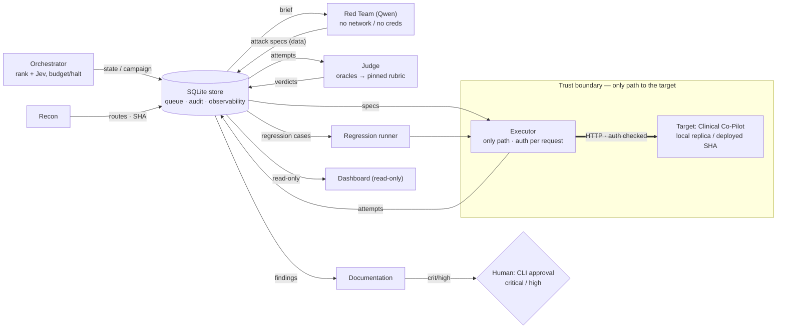

# Architecture

> PRD Stage 4 hard gate. Companion records: `docs/adr/0001–0003`, `CONTEXT.md`
> (vocabulary), `docs/PLAN.md` (requirements matrix + decision log). Threat model
> (`THREAT_MODEL.md`) and users (`USERS.md`) are written in the same workstream and are
> the inputs this plan assumes.

## Summary

The AgentForge Red Team platform continuously attacks one authorized target — the
AgentForge Clinical Co-Pilot — and proves whether its weaknesses are found, fixed, and
stay fixed, at a standard a hospital CISO would trust to run unattended. The design is a
**deterministic control plane coordinating four LLM agents and three deterministic
services over one SQLite store** that is simultaneously the work queue, the ordered audit
trail, and the observability substrate the Orchestrator reads. The store as single source
of truth is the spine: every handoff, every audit record, and every signal the
Orchestrator prioritizes on is the same set of rows, so there is no second state store to
drift.

Four requirements are structural, not conventional, and they drove the shape. First,
**Judge independence**: attack generation and evaluation never share a context or a model
family, because an engine that both attacks and grades is compromised by design. Second,
**authorization by construction**: a single deterministic Executor is the only component
that can reach the target, and it checks an authorization registry on every request, so
the platform cannot be pointed at a system it does not own — the least-trusted component,
the Red Team Agent, holds neither network access nor credentials and emits attack text
only as data. Third, **auditability**: every agent action is an ordered row, and lineage
links any finding back through its verdicts, attempts, mutation ancestry, and the
Orchestrator decision that surfaced it. Fourth, **honest verdicts**: deterministic
oracles (canaries, state diffs, scope and schema checks) decide first; an LLM rubric tier
runs only where no oracle exists; degraded target behavior and upstream provider content
blocks are distinct outcomes, never counted as a pass.

The agents are the **Orchestrator** (hybrid: a deterministic ranker over coverage,
findings, regressions, and cost, with a pinned Jev model choosing among top candidates and
hard budget/halt rules it cannot override), the **Red Team Agent** (Qwen; generates and
mutates attacks and multi-turn sequences), the **Judge Agent** (oracles first, then a
pinned non-Qwen rubric model, validated against a human-labeled calibration set), and the
**Documentation Agent** (turns a confirmed finding into a professional report). The
deterministic services are the **Executor** (the sole path to the target), the
**Regression runner** (replays frozen cases on every new target SHA), and **Recon**
(route and SHA inventory). Human approval gates sit where a wrong autonomous call is
expensive: publishing critical/high reports, reviewing inconclusive and clinical-harm
verdicts, and changing the authorization registry. The platform never proposes or applies
fixes to the target; it only recommends remediation in report text.

Cost is controlled by putting the cheapest components on the highest-volume paths:
deterministic oracles ($0) and Jev (~$0.04/M tokens) run on every attempt and every
orchestration decision, while the costlier Qwen and rubric-model calls fire only when a
case needs generation or open-ended judgment. That shape, not a per-token multiple, is
what keeps the projection to 100K runs defensible.

## Agents and services

Each row gives role, inputs → outputs, trust level, and how it coordinates. Message
shapes are versioned JSON Schemas in `/contracts`; every record is exchanged through the
store, not by direct call.

| Component | Kind | Role | In → Out | Trust | Coordination |
|---|---|---|---|---|---|
| **Orchestrator** | Agent (Jev + deterministic) | Chooses the next campaign: surface, cases, budget | store state (coverage, open findings, regressions, cost) → a `Campaign` | Trusted to decide; **cannot** override budget/halt/authorization | Writes campaigns to the store; triggers regression runs |
| **Red Team** | Agent (Qwen) | Generate novel inputs, mutate partial successes, specify multi-turn sequences | `Campaign` brief → `AttackSpec[]` (data only) | **Least trusted** — writes adversarial text; no network, no creds | Reads briefs, writes specs to the store |
| **Judge** | Agent (oracles + pinned non-Qwen rubric) | Rule success / partial / fail / inconclusive | `Attempt` → `Verdict` + evidence | Independent of the attack engine | Reads attempts, writes verdicts; feeds the regression harness |
| **Documentation** | Agent | Confirmed finding → professional report | `Finding` → `VulnReport` | Writes reports; critical/high behind a human gate | Reads findings, writes reports; validates data-quality before write |
| **Executor** | Deterministic service | The only path to the target; auth check per request; plays out multi-turn specs | `AttackSpec` → `Attempt` (exact req/resp) | Holds credentials + synthetic identities; enforces the boundary | Reads specs, writes attempts; rate-limits and backs off |
| **Regression runner** | Deterministic service | Replay frozen cases on each new SHA; detect reappearance + cross-category regressions | `RegressionCase[]` + new SHA → `Attempt[]` | Deterministic replay | Triggered by the Orchestrator; runs through the Executor |
| **Recon** | Deterministic service | Route/SHA inventory; poll `/health` for target change | target-visible metadata → coverage + SHA signals | Read-only against the target | Writes signals the Orchestrator prioritizes on |

Deterministic, human-facing outputs: a **read-only dashboard** (coverage per category,
pass/fail over versions, resilience trend, open findings, cost) and a **CLI approval**
path that writes an approval record into lineage.

## Interaction diagram

## The eight Stage-4 questions

1. **Which agent owns each function.** Attack generation → Red Team. Evaluation → Judge.
   Strategic prioritization → Orchestrator. Reporting → Documentation. Execution against
   the target → the deterministic Executor (not an agent, deliberately). Regression replay
   and recon are deterministic services.
2. **How agents communicate.** Versioned JSON Schemas in `/contracts` (min `v1`), one per
   message type (`Campaign`, `AttackSpec`, `Attempt`, `Verdict`, `Finding`, `VulnReport`)
   plus typed error schemas. Exchange is through store rows, not direct calls, so a slow or
   failed agent never blocks a producer. Breaking change ⇒ version bump + migration note +
   updated contract tests. Contracts are written so an independently built agent could plug
   in through the schema alone (solo build, plug-in-ready — see `docs/PLAN.md` R3).
3. **How the Orchestrator picks the next target.** A deterministic score over (a) never/
   rarely visited workflow edges, (b) routes/schemas changed since the last tested SHA,
   (c) high-impact invariants and prior findings, (d) estimated campaign cost. Jev picks
   among the top-k and logs per-option probabilities; three confidence bands decide whether
   to take its pick, fall back to the deterministic top-1, or flag it — never stalling
   overnight. Inputs and weights are stored, so any choice is auditable and replayable.
4. **How Judge verdicts feed regression.** A `SUCCESS` verdict, once confirmed, promotes
   its attempt to a frozen `RegressionCase` (deterministic, versioned, queryable). The
   Regression runner replays these on each new SHA; a case flips to `INCONCLUSIVE` — not
   pass — if retrieval degraded or an upstream provider block occurred, because those are
   not evidence the defense held.
5. **Where human gates sit, and why.** Publishing critical/high reports; reviewing
   inconclusive and clinical-harm verdicts; changing the authorization registry. These are
   the points where a wrong autonomous action is costly or irreversible. Autonomous:
   in-budget campaigns, finding→regression promotion, medium/low reports. **Never**: the
   platform proposing or applying fixes to the target.
6. **AI vs deterministic, and why.** AI where the task is open-ended language: attack
   generation/mutation (Red Team), campaign selection among ranked options (Jev), and
   rubric judgment where no oracle exists. Deterministic everywhere a wrong or drifting
   result is unacceptable: the authorization gate, budget/halt, oracles (canaries, state
   diffs, scope/schema checks), regression replay, and the ranker that feeds Jev.
7. **Cost, rate limits, model constraints at scale.** Cheapest components on the
   highest-volume paths (oracles $0, Jev ~$0.04/M). Red Team on David's direct Qwen key
   (highest quota); the target's own free-tier Gemini embedding quota is moved off so it
   cannot silently degrade tests. Every external API's rate-limit handling is explicit:
   the Executor backs off and queues target/LLM calls; a hard budget stop is a valid
   `INCONCLUSIVE`, never a pass. Provider content blocks are typed outcomes with a
   non-Alibaba fallback. Full 100/1K/10K/100K projection lives in the cost analysis.
8. **State + coordination infra.** A hand-rolled control plane over SQLite (ADR 0001) — no
   graph/agent framework — because the coordination is queue items and audit rows, and one
   store keeps handoffs, audit, and orchestration signals identical. LangGraph was the
   nearest alternative and is the documented revisit trigger if agent count or branching
   grows.

## AI-use disclosure

| AI role | Model | Deterministic check / human gate that follows | Residual risk |
|---|---|---|---|
| Red Team | Qwen (direct key) | Its output is data; the Executor, not the agent, sends it; oracles judge the result | Provider content filter may block some generations (typed outcome, non-Alibaba fallback) |
| Orchestrator selector | Jev, pinned `jev-1.13.0` | Deterministic ranker produces the candidate set; budget/halt/auth are deterministic and unoverridable | Jev base model undisclosed; independence from Qwen rests on owner knowledge, disclosed here |
| Judge rubric tier | `deepseek-v4-pro` via Bailian (non-Qwen family; the planned bake-off has not run) | Deterministic oracles decide first; only oracle-less criteria reach the model; human lane for clinical harm | LLM judge bias/drift — mitigated below |
| Documentation | Agent model | Data-quality validation before write; human approval for critical/high | False-positive report wastes engineer time; gate + dedup mitigate |

**Detecting and correcting a drifting Judge.** Three defenses: (1) pinned model **and**
pinned provider, so weights cannot change silently — a retired pinned version is treated
as a Judge change that triggers recalibration; (2) a human-labeled calibration set (20–30
synthetic cases) scored for agreement (Cohen's κ), rerun stability, and resistance to
judge-directed injected text, re-run after any judge prompt/model change; (3) if the
bake-off supports it, a **two-judge pairing** whose disagreement rate is a continuous,
label-free drift alarm the Orchestrator can read.

## Known tradeoffs, failure modes, and edge cases

Written for the Architecture Defense: each is a "what happens when / why X over Y" answer.

| Situation | Behavior | Rationale |
|---|---|---|
| **Executor is a single bottleneck** | Accepted by design; rate-limit/backoff/budget live there | One door is what makes authorization structural; throughput is a load-test concern (E14), not a correctness one |
| **Target unreachable / 5xx** | Typed `target_unreachable` error; campaign halts, not fails silently | A missing verdict is never a pass |
| **Budget exceeded mid-campaign** | Hard stop → `INCONCLUSIVE` outcome, checkpointed for resume | Cost accruing without signal must halt (PRD) |
| **Judge uncertain / oracle-less** | `INCONCLUSIVE` → human review queue | Fail closed; never guess a security verdict |
| **Provider content block** (attacker or target side) | Distinct `provider_block` outcome; attacker side retries via fallback; target side → `INCONCLUSIVE` | A filter is not the target's defense holding |
| **Target degrades to `sparse_only`** (embedding quota) | Marked `INCONCLUSIVE`; not counted | A test passing on shifted behavior is worse than none |
| **Agent crash / timeout** | Work item stays queued; retry with cap; no partial-state corruption | Store is the only state; nothing hidden in agent memory |
| **Regression "passes" after a fix** | Only counts if the same oracle fires on the same seed on the new SHA; behavior-shift alone does not pass | PRD's central regression warning |
| **Red Team output is itself harmful** | Never executed except through the Executor against the authorized synthetic target; stored as data, redaction-checked | Synthetic-only, single-target boundary |
| **Why not LangGraph / CrewAI / one red-team tool** | See ADR 0003 considered-options table | Second state store / shared-context judge / missing orchestrator+harness+docs |

## Standing risks to watch

- We own retry/timeout/recovery logic a framework would provide; failure drills must test
  it explicitly.
- Pinned hosted model versions can be retired without notice; that is a Judge/selector
  change and forces recalibration.
- Jev's base model is not publicly stated; independence is owner-asserted.
- Two decisions are deferred to measured bake-offs, not left open: the Red Team model and
  the Judge rubric model (criteria in `docs/PLAN.md`).

## Discovery tier (open-ended, candidate-only) — added 2026-09-30

Beyond the verdict-issuing Judge, the platform has a **Discovery tier**
(`src/redteam/agents/judge/discovery.py`, `src/redteam/discovery.py`): an independent
less-safeguarded LLM (non-Qwen by default; an explicit same-family model is honored) that reviews
each captured ⟨request, response⟩ with **no checklist** and emits **candidates** — leads for human
triage, never verdicts and never findings. It exists because the deterministic oracles and the
rubric tier only recognize pre-encoded classes; the Discovery tier finds classes with no oracle
yet. A human hardens a confirmed candidate into a deterministic oracle+probe (this produced the
`MetadataDisclosureOracle` / F-ca9486ff1b). It is structurally separate from the Judge: it writes
only to `discovery_candidates`, never to `findings`, so a drifting LLM can never publish a security
verdict. It runs over stored evidence (`redteam discover`) and in the scheduled loop
(`redteam poll --discover`: poll → regression → discover).

## Implementation status vs this document (2026-09-30, honest)

Reconciled against the code after the 09-30 work. Corrections to the earlier (09-29) status, which
now **under-claimed** several capabilities:

- **Judge — deterministic tier-0 + rubric tier both live and exercised end-to-end.** Tier-0 is
  independent and consistent by construction. The rubric tier (`deepseek-v4-pro`, non-Qwen) has now
  run **end-to-end against the live target** (a 9× excessive-agency campaign on SHA `da7451d1`, all
  rubric-judged safe). Deterministic oracles now include **`GroundingOracle`** (off-condition
  misinformation, LLM09) and **`MetadataDisclosureOracle`** (internal-implementation disclosure,
  API3/LLM02), both gated by an Observation flag so they fire only on their dedicated probes.
- **Judge validation (drift/κ): machinery built, NOT yet measured.** `drift.py` computes agreement
  + Cohen's κ against a human-labelled calibration set; the set (`evals/calibration/`) ships
  **empty** pending human-authored labels, so "validate the judge" is unmeasured. This is the one
  genuinely-open Judge item.
- **Orchestrator → regression on SHA change: NOW WIRED.** The Recon poller (`redteam poll`,
  `src/redteam/recon/`) reads `/health` `git_sha`; on a change it runs the regression suite and
  records the trigger — the SHA-diff producer + trigger the 09-29 note said were missing. Ranking
  still uses route-coverage + open findings (2 of 4 signals); cost remains the `--max-model-calls`
  cap, not a ranking signal; mid-campaign hard-stop is between-campaigns only.
- **Regression — auto-trigger + cross-category flagging: DONE; CI gate: not done.** Faithful
  per-probe replay (`probe_kind` reconstruction), reappearance detection, **cross-category
  regression flagging** (`RegressionReport.cross_category_regression`), and SHA-change auto-trigger
  via the poller. Only a CI regression gate is still CLI-only.
- **Red Team — multi-turn: N/A** (target composer stateless, verified); mutation is a single
  guarded rephrase.

Built and verified: the single-door Executor boundary, deterministic tier-0 Judge + rubric tier,
aimed generation with identity-lock, dedup/reclassification, evidence capture, the fail-closed
Documentation gate, faithful regression replay, the SHA-change poller, the Discovery tier, and the
six observability queries. See the requirements matrix in `docs/PLAN.md` for per-requirement
status.
