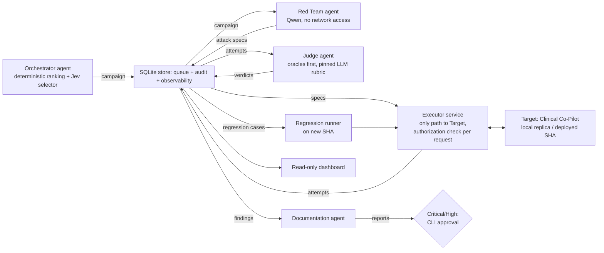

# Platform architecture: considered shapes and the one we chose

The platform is four isolated agents (Orchestrator, Red Team, Judge, Documentation) and
three deterministic services (Executor, Regression runner, Recon), coordinated by a
deterministic controller over one SQLite store that is at once the work queue, the audit
trail, and the observability data the Orchestrator reads. We chose it because the PRD's
hardest requirements are structural: the Judge must be independent of the attack engine,
every agent action must be ordered and replayable, the Orchestrator must decide from real
system state, and the platform must be impossible to point at an unauthorized system.
Each is satisfied by construction rather than by convention. Decisions below were settled
in a grilling session on 2026-09-28 (Q1–Q15); `docs/PLAN.md` holds the running record.

## Architectures considered

| Shape | Verdict | Why |
|---|---|---|
| Static test runner or LLM pipeline | Rejected | PRD: "a single-agent or pipeline architecture will not satisfy this assignment." Cannot mutate, prioritize, or adapt. |
| One autonomous agent that plans, attacks, and judges | Rejected | Generating and grading attacks in one context is "compromised by design" (PRD p4). |
| Conversational multi-agent (AutoGen, CrewAI) | Rejected | Agents share a conversation, so the Judge sees the attacker's reasoning; turn-taking is nondeterministic and costly. |
| Graph framework (LangGraph) | Rejected, revisit if roles grow | Viable, but its checkpointer is a second state store beside the one the Orchestrator must read. See ADR 0001. |
| Configure one red-team tool as the platform (PyRIT, garak, promptfoo) | Rejected as the core | None has an orchestrator, regression harness, or documentation agent. Planned as components instead; not wired (ADR 0005). |
| **Deterministic control plane + shared store + isolated agents** | **Chosen** | One source of truth; independence and authorization are structural. ADR 0001, ADR 0002. |

## How it fits together

## Decisions and why

| # | Decision | Why |
|---|---|---|
| Q1 | Lifecycle nouns: seed case → variant → attempt → verdict → finding → vulnerability report → regression case (`CONTEXT.md`) | Finding (the weakness) is separate from attempts (the evidence), so dedup and "fix held across variants" are expressible. |
| Q10 | Lineage on demand, including the decisions behind records: Orchestrator inputs and choice, mutation ancestry, Judge and oracle versions | Any finding can be explained back to the campaign that surfaced it. Full LLM transcripts kept only where audit needs them. |
| Q2 | Custom control plane over SQLite (ADR 0001) | One store for handoffs, audit, and orchestration signals. |
| Q9 | Executor is the only component that reaches the Target (ADR 0002) | The least-trusted agent never holds network access or credentials; authorization cannot be bypassed. |
| Q4, Q13 | Hybrid Orchestrator: deterministic ranking and hard budget/halt rules; Jev (pinned) picks among top candidates with three confidence bands | Real decision authority, auditable inputs, never stalls overnight; safety controls stay deterministic. |
| Q3, Q12 | Volume runs on a local replica of the real Co-Pilot; findings re-confirmed on the deployed SHA; Target embeddings moved off a free-tier quota | The deployed Target's quota cannot support campaigns; degraded retrieval is marked inconclusive, never a pass. |
| — | Provider blocks are a distinct outcome | An upstream content filter stopping a response is not evidence the Target's defense held. |
| Q5 | Red Team: Qwen on David's direct key, model chosen by a measured bake-off | Cheapest option; refusal and filter-block rates are measured, not assumed. |
| Q8′, Q14 | Judge: deterministic oracles first; LLM rubric tier chosen by bake-off (DeepSeek pinned default; Jev and a third-vendor model as candidates); possible two-judge pairing | Pinned weights prevent silent judge drift; judge disagreement rate is a continuous drift alarm. |
| Q6, Q15 | Human gates: Critical/High report publication, inconclusive and clinical-harm review, authorization-registry changes; approvals by CLI; dashboard read-only | Humans sit where a wrong autonomous call is costly; the platform never proposes or applies fixes to the Target. |
| Q11 | End state: container beside the Target polling its SHA; scheduled jobs for now | Regression runs trigger on Target change without cross-repo CI coupling. |
| Q7 | Designed for an unattended drill (one command, bounded, resumable, real exit code), not built for one | Costs little beyond PRD requirements and hedges an unannounced drill. |

## Still to measure (not open decisions)

- Red Team model bake-off: refusal and provider-block rate, valid-variant rate, cost.
- Judge bake-off: agreement with human labels, resistance to judge-directed text, rerun
  stability, cost per verdict.

## Known risks

- We own retry, timeout, and recovery logic a framework would give us; failure drills
  must test it.
- The Executor is a deliberate throughput bottleneck.
- Jev's base model is not stated in public docs; its independence from Qwen rests on the
  owner's knowledge and is disclosed as such.
- Pinned hosted model versions can be retired without notice; retirement is a Judge
  change and triggers recalibration.

## Implementation status (2026-10-01)

Built as decided: the agent set, the single Executor, the hybrid Orchestrator (a deterministic
ranker, with Jev optional and never observed live), the fail-closed human gates for critical and high
reports and registry edits (by CLI), provider blocks as a distinct outcome, and a read-only
dashboard (a static file). Not built or different from the table: the **local replica** and the move of
the target's embeddings off a free-tier quota (Q3, Q12; the replica is `enabled: false` in
`authorization.yaml`); the **Red Team and Judge bake-offs** (not run; the rubric model is a pinned
non-Qwen default, DeepSeek in use); the **two-judge pairing**; the **inconclusive and clinical-harm
review lanes** (Q6; inconclusive verdicts are counted, not queued); the **unattended drill** (Q7; no
`drill` command); and the **Documentation agent is deterministic**, not an LLM. SHA-change polling
(Q11) exists as `redteam poll` but nothing schedules it. The ranker uses two signals (per-route
coverage and open findings), not four. `ARCHITECTURE.md` carries the current status table.
